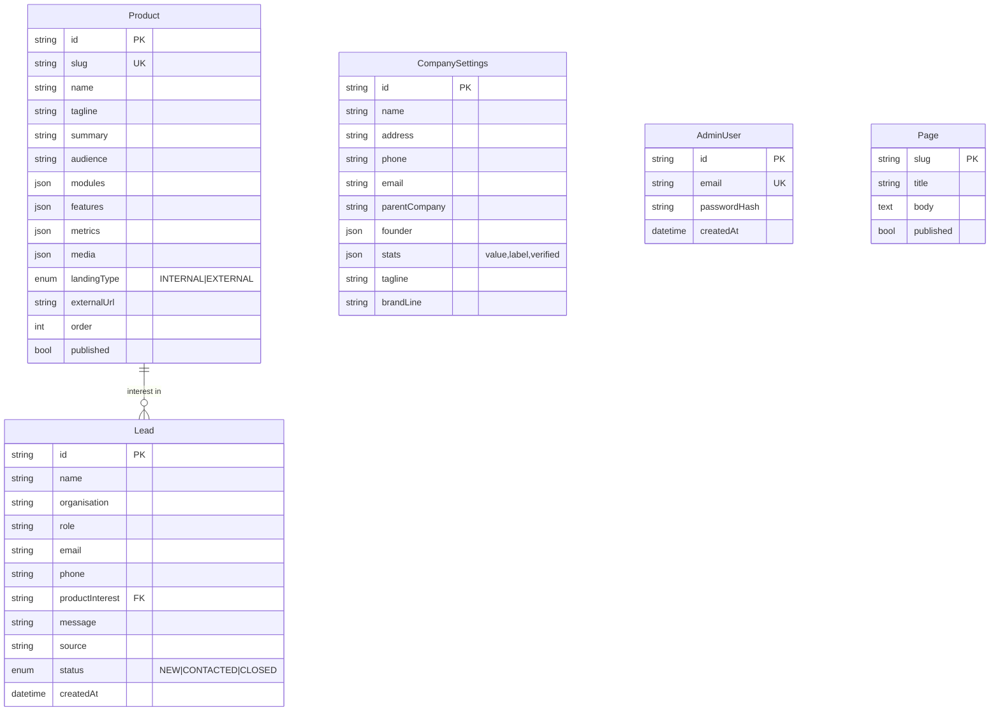

# 02 – Plan (Phase 1, awaiting approval)

Defaults taken where you did not answer: VPE Aditi Agarwal **not** shown; public contact email = info@apricitydigital.in (it@ appears only inside the carried-over Support Policy text).

## 1. Architecture and repo decision

**One monorepo, two apps** (npm workspaces), root = `c:\HMS 2\apricity` (no nested folder).

```
apps/web         Next.js (App Router) + TypeScript + Tailwind + Framer Motion
apps/api         Node + TypeScript + Fastify + Prisma
packages/shared  zod schemas + TS types (Product, Lead, Settings…)
docs/  legacy/  docker-compose.yml  .env.example
```

Why one repo: one team and one prototype; shared zod types stop frontend/backend drift; atomic commits across both apps; one CI. Each app builds and deploys on its own, so splitting later means moving a folder and publishing `packages/shared`. No concrete reason found to recommend two repos.

**Fastify, not NestJS.** The API is ~15 routes. Fastify gives schema validation, rate limiting, helmet, cookies, CSRF and Swagger plugins with little ceremony. NestJS adds structure we don't need yet.

**Package manager:** npm workspaces (no new tooling to approve).

## 2. Backend

**Stack:** PostgreSQL + Prisma, Postgres-compatible schema, SQLite not used (docker-compose gives Postgres in one command). Seeds: company settings, 3 products, 1 admin from env.

### ER diagram

Rule enforced in zod and the DB layer: `EXTERNAL` ⇒ `externalUrl` required (https only) and no internal landing page; `INTERNAL` ⇒ landing content required.

### Public API (`/api/v1`)
| Method | Path | Notes |
|---|---|---|
| GET | `/products` | published only, ordered |
| GET | `/products/:slug` | 404 if unpublished |
| GET | `/settings` | company settings |
| GET | `/pages/:slug` | legal pages |
| POST | `/leads` | zod-validated, rate-limited, honeypot field (Turnstile-ready hook), saves, emails info@ via SMTP adapter (console logger in dev) |

### Admin API (cookie session, CSRF token)
| Method | Path | Notes |
|---|---|---|
| POST | `/admin/login`, `/admin/logout`, GET `/admin/me` | argon2 hashes; httpOnly + SameSite cookie |
| GET/POST/PUT/DELETE | `/admin/products`, `/admin/products/:id` | PUT `/admin/products/reorder` |
| PUT | `/admin/settings` | |
| GET / PATCH | `/admin/leads`, `/admin/leads/:id` | PATCH = status |
| GET | `/admin/leads.csv` | CSV export (cells starting `= + - @` are escaped against spreadsheet formula injection) |
| PUT | `/admin/pages/:slug` | legal pages |

Security: zod on every input, CORS locked to web origin, helmet, rate limits (stricter on login and `/leads`), CSRF for cookie auth, no secrets in repo, `npm audit` in QA. Docs at `/docs` (OpenAPI). Tests: Vitest + supertest for products, leads, admin auth refusal.

Web fetches use ISR (`revalidate` ~60 s) plus on-demand revalidate after admin saves; a seeded JSON fallback in `apps/web` is used if the API is down.

## 3. Frontend

### Route table
| Route | Purpose |
|---|---|
| `/` | Hero (animated command-centre SVG), proof strip, product cards, platform story, how it works, who we serve, CTA |
| `/products` | index of cards |
| `/products/[slug]` | one dynamic landing page; only for `INTERNAL` products (`matrix-track-2`, `matrix-track`); `EXTERNAL` → 404 |
| `/about` | story, parent company, CEO block, address |
| `/contact` | form → `POST /leads`, phone/email/address/map link |
| `/careers` | simple "coming soon" + email (no CV upload in prototype) |
| `/privacy-policy`, `/terms-and-conditions`, `/support-policy` | live text carried over, `// CONFIRM` banner (internal note, not public text) |
| `/admin`, `/admin/login`, `/admin/products`, `/admin/settings`, `/admin/leads` | admin panel |
| `/sitemap.xml`, `/robots.txt` | generated |

Header: Products, Solutions, About, Careers, Contact + "Request a demo" (opens lead modal). "Solutions" = in-page anchor to the "Who we serve / platform" section on `/` (no separate page in the prototype). Redirects (301): `/technology`→`/about`, `/about`(old Services)→`/products`, `/blank-1`→`/products/matrix-track-2`, `/blank-2`→`/careers`, `/terms-and-coniditions`→`/terms-and-conditions`, `/blank-4-1`→`/support-policy`, `/blank-4`→`/` (TaskForce retired). Note old `/about` and new `/about` share a path with different meaning; cutover must handle it explicitly.

### Design direction
**"Civic control room"**: deep ink background panels with a warm apricot accent (from the logo) on light paper surfaces, one accent only. Type pairing: a sturdy grotesque display (e.g. Space Grotesk) + a neutral text face (Inter), both self-hosted via `next/font`. Data-rich: ward scorecards, live counters, GIS map, all built in SVG/CSS. Lucide inline icons, no photos of people, no emoji. Motion: subtle, CSS-first, Framer Motion only for hero and card transitions, all gated by `prefers-reduced-motion`. WCAG AA, keyboard navigable, visible focus. The `frontend-design` skill is not installed; I follow these rules directly.

### Components
Header, Footer (parent-company line, legal links, © 2026), Container/Section, Button, ProductCard (whole card is the link; external badge + `target=_blank rel="noopener noreferrer"`), HeroCommandCentre, StatStrip (shows unverified stats), ModuleGrid, StepsFlow, AuditFlowDiagram, DashboardMockup, FAQ, LeadForm + DemoModal, LegalPage, AdminShell, ProductForm, SettingsForm, LeadsTable, ReorderList.

### Product content (only what the brief gives)
- **Matrix Track 2.0** – command & control for municipal/enterprise heads: modules (Matrix Track attendance, Swachh Parvv, Task Force, MRF & processing, Survekshan, Commissioner View), GIS asset map, audit flow (geo-tagged photo → AI hygiene score 1–10 → Sector In-charge → Commissioner; planned vs actual manpower → penalties), 20 % rule, "assets" wording, claims capped at "go-live in days; results in about 2 weeks once all workforce and locations are registered". No city or client named. The old site's Swachhata Setu / Deployment Plan Monitoring names are not reused.
- **Matrix Track** – face attendance 1:1 and 1:N, geotagging, leave management; also entry module of 2.0.
- **Insstanto** – external card, one modest line aligned to its title, `// CONFIRM`.

### Legal pages
Live Privacy, Terms and Support text imported verbatim into the `Page` table (editable in admin) and shown as-is. Known text issues listed in `01-site-review.md` §5.

## 4. SEO
Per-page metadata, OG/Twitter tags with a generated OG image (logo on brand panel), canonical URLs, `sitemap.xml`, `robots.txt`, JSON-LD: `Organization` (name, address, telephone, email, `parentOrganization: Human Matrix Securite`, founder), `SoftwareApplication` per internal product. Analytics: env-gated placeholder, off by default.

**Performance budget:** home JS ≤ 170 KB gzip, LCP ≤ 2.5 s on mobile profile, CLS < 0.1; hero animation CSS/SVG, below-fold sections lazy; fonts self-hosted with `display: swap`. Target Lighthouse 95+ ×4.

## 5. Dev and deployment
`docker compose up` = Postgres + api + web; `npm run dev` = web + api with a local Postgres from compose. Seed prints a **dev-only** demo admin (credentials from env/README, never hard-coded in code).

Deployment proposal: web on Vercel (or any Node host); API + Postgres on Render/Railway/a VPS. Cutover from Wix: deploy to a staging subdomain, review, add the 301 map above, then switch DNS at the registrar; keep MX/email records untouched so mail is unaffected. **Not done in this project; nothing touches the live domain or DNS.**

## 6. Tasks and estimates (prototype, one developer + AI)
| # | Phase | Est. |
|---|---|---|
| 1 | Scaffold monorepo, tooling, shared package, compose, `.env.example` | 0.5 d |
| 2 | API: schema, seeds, public endpoints, leads + email adapter | 1.5 d |
| 3 | API: auth, admin endpoints, CSV, OpenAPI, tests | 1.5 d |
| 4 | Web: tokens, layout, header/footer, shared components | 1 d |
| 5 | Home, hero, product cards, products index | 1.5 d |
| 6 | Two product landings, About, Contact, Careers, legal | 1.5 d |
| 7 | Admin panel (login, products, settings, leads) | 2 d |
| 8 | SEO, OG image, redirects, fallback data, polish | 1 d |
| 9 | QA, Lighthouse fixes, copy review, docs/summary | 1.5 d |

Commit suggestions are given after each step; you run all git commands.

## 7. QA checklist
Build, lint, typecheck, tests green in both apps · contact form → admin lead + email log · add product in admin → appears · set EXTERNAL → card goes to external URL (new tab, noopener) · unpublish → disappears · 360/768/1280/1920 px · keyboard and contrast · every link incl. https://insstanto.com/ · kept-facts check char-for-char (name, address, phone, email, copyright) · unauthenticated `/admin` refused, rate limits work, no secrets committed · grep for `TaskForce`, old web-dev block copy (not the parent-company name), `Lorem`, `TODO`, any city/corporation named as client · copy review for typos and overclaims · Lighthouse ≥ 95.

## 8. Risks and open questions
1. Stats (11+/40+/200+) shown as `verified: false`; "Cities" may read as a deployment claim: Director to confirm.
2. Legal text carried over unedited; "© 2022", "registered trademarks", "Apricity Digital Lab" naming need company review.
3. VPE Aditi Agarwal: omitted unless you say otherwise.
4. Founder photo: none (not requested).
5. Human Matrix Securite: no logo found; text-only in footer, About and JSON-LD unless you supply one.
6. Logo: PNG only (450×372); a vector version would be better for headers and OG image.
7. insstanto.com wording needs a browser check.
8. SMTP credentials, hosting choice, admin user list, support email (info@ vs it@).
9. Major dependencies beyond the stack (needing your OK): `@fastify/*` plugins, `argon2`, `zod`, `lucide-react`, `vitest`, `supertest`, `@fastify/swagger`. All standard; I will treat them as approved unless you object.
10. Dual `/about` meaning at cutover (see redirects).

**Stopping here for your approval before building.**
